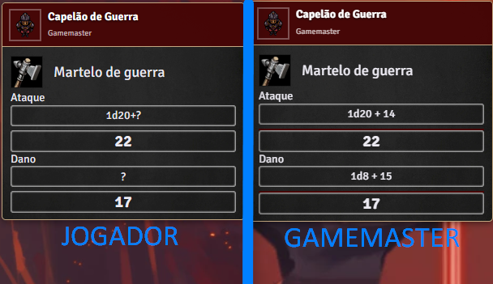
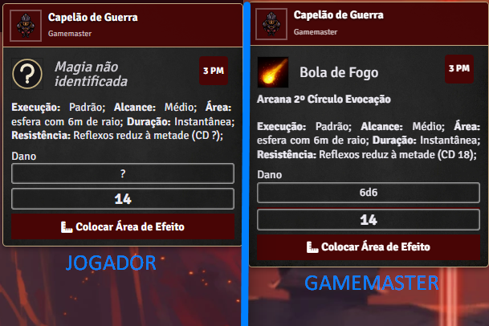
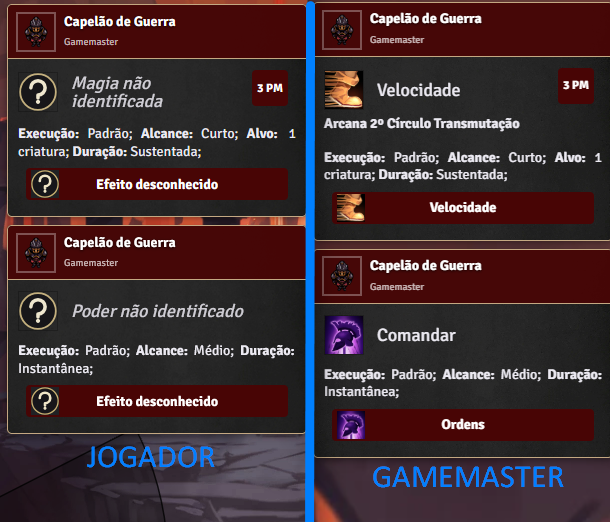
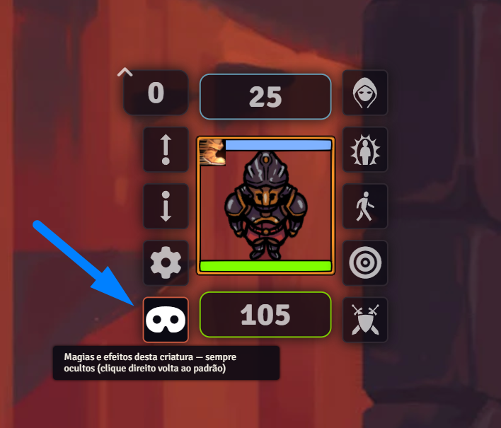
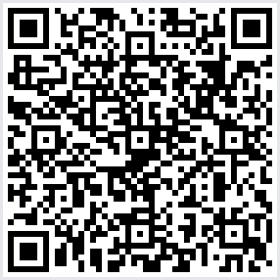

[](https://ko-fi.com/haydgi)

# T20 Hayd GMTools

Ferramentas de Mestre para o sistema **Tormenta20**: O módulo tem como objetivo entregar diversas ferramentas e automações para auxiliar na hora de jogo, algumas de suas funções incluem: ocultar dos jogadores os detalhes das rolagens e habilidades das criaturas do Mestre, permite rerolar ou inserir resultados manualmente pelo chat, gera e distribui tesouros pelas tabelas dos livros, reúne o grupo numa ficha compartilhada com estoque e dinheiro em comum, oferece uma régua opcional para efeitos que ignora diagonais, adiciona um assistente completo de definição de atributos iniciais e um assistente de criação de personagem que conduz por raça, classe, origem, divindade, magias e equipamento até a ficha pronta.

## Requisitos

- FoundryVTT **v13**
- Sistema **Tormenta20**

## Instalação

Em *Configurar → Módulos Complementares → Instalar Módulo*, cole a URL do manifesto:

```
https://github.com/ahahayd/t20-hayd-gmtools/releases/latest/download/module.json
```

## Como usar

### Ocultar detalhes das criaturas do Mestre

Funciona automaticamente após ativar o módulo. Rolagens de NPCs e Perigos mostram o total, mas mascaram a fórmula (`1d20+?`, dano `?`), o breakdown e o destaque de crítico; cards de magias e poderes escondem descrição, aprimoramentos e CD. Donos e observadores da criatura continuam vendo tudo, e personagens jogadores nunca são afetados.



*A mesma rolagem de arma nas duas telas: o total é o mesmo, o bônus não aparece.*

O que fica oculto é escolhido no **Nível de metagame** (veja abaixo) — dá para esconder tudo, só parte, ou desabilitar a função por completo.

### Nível de metagame

Em *Configurar → Configurações → T20 Hayd GMTools → Nível de metagame*, o Mestre marca item a item o que os jogadores **não** podem ver nas criaturas dele:

| Opção | O que esconde |
| --- | --- |
| Soma do ataque | A fórmula vira `1d20+?` em vez do bônus real (o total continua visível) |
| Rolagem de dano | A fórmula do dano vira `?` (o total continua visível) |
| CD de magias e habilidades | `CD 15` vira `CD ?` no cartão do chat |
| Descrição de magias e poderes | O texto e os aprimoramentos do cartão |
| Nome de magias e poderes | Nome, ícone, escola e nível — o cartão vira "Magia não identificada" |
| Efeitos ativos nas criaturas | Ícone e nome dos buffs sobre o token viram "?" |
| Destaque de crítico e falha | O verde do crítico e o vermelho da falha no total |
| Animação dos dados | Os dados 3D do Dice So Nice na tela dos jogadores |



*Várias chaves agindo no mesmo cartão: nome, escola, CD e fórmula de dano ocultos, o total do dano e a área continuam visíveis, porque o jogador precisa deles para jogar.*

Independentemente da configuração, o Mestre pode revelar ou reocultar uma mensagem específica pelo menu de contexto do chat.

> Em mundos que já usavam o módulo antes, as duas chaves novas (*Nome de magias e poderes* e *Efeitos ativos nas criaturas*) entram **desligadas**, para não mudar a mesa sem o Mestre pedir. Mundos novos já vêm com tudo oculto.

Com o **Dice So Nice**, o dado 3D do mestre não rola na tela do jogador, evitando que o jogador veja o resultado na animação 3D.

### Magias, poderes e efeitos não identificados

Com essas chaves ligadas, o que a criatura do Mestre faz chega ao jogador anônimo:



*Execução, alcance, alvo e duração continuam à vista, o jogador sabe que algo foi conjurado e como reagir, sem saber o quê.*

- **No chat** o cartão da conjuração vira *Magia não identificada* (ou *Poder não identificado*), com ícone de "?", sem escola nem nível, e os botões de aplicar efeito também ficam mascarados.
- **No token** os ícones dos efeitos viram "?" e o texto flutuante que o Foundry mostra ao aplicar um efeito passa de `+(Velocidade)` para `+(Efeito desconhecido)`. Condições do sistema (caído, cego, abalado…) **não** são mascaradas.

Três controles ajustam isso:

1. **Revelar magia/poder** — botão direito na mensagem do chat. Devolve nome, ícone e rótulos daquela conjuração; *Ocultar magia/poder* desfaz. (A entrada *Mostrar fórmula para os jogadores*, que já existia, revela a mensagem inteira.)
2. **Padrão da criatura** — o botão de máscara no HUD do token (clique com o direito no token). Clique esquerdo força *sempre oculto* ou *sempre visível* para aquela criatura; clique direito volta a seguir o nível de metagame. Em tokens **não vinculados** a marcação vale só para aquele token (cada goblin da cena tem a sua); em tokens vinculados, vale para o ator inteiro.
3. **Efeito identificado** — campo na aba *Detalhes* da ficha do efeito ativo, com três valores: *Padrão da criatura*, *Sim* (nome e ícone normais) e *Não* (vira "?"). Serve tanto para revelar um efeito específico quanto para esconder um que seria público.



*O botão de máscara no HUD define o padrão daquela criatura, sem precisar abrir as configurações.*


*O campo **Efeito identificado** fica no fim da aba Detalhes do efeito ativo, e vale só para aquele efeito.*

### Rerolar e inserir resultados

Clique com o botão direito em uma mensagem de rolagem no chat para **rerolar** (mantendo todos os bônus, sem cobrar mana de novo) ou **inserir manualmente** o resultado do dado — útil para poderes que permitem escolher a rolagem. Em cards de arma, ataque e dano são tratados separadamente, e se o ataque virar (ou deixar de ser) um crítico, o dano é recalculado sozinho. Rolagens alteradas ganham um símbolo com o resultado anterior riscado.


*Ataque e dano aparecem como entradas separadas, então dá para refazer um sem mexer no outro.*

### Gerador de tesouros

O botão do saco de moedas na barra de ferramentas de tokens (só para o Mestre) abre o **Gerador de Tesouros**, que segue as tabelas de tesouro citada abaixo, criada pelo Svaldi: você escolhe o nível de desafio e o tipo de cada coluna — **Normal** (rola uma vez), **Dobro** (rola duas e acumula) e **Metade** (a tesoura ao lado do valor corta o dinheiro pela metade), e o gerador rola automaticamente, ou auxlia na rolagem de cada tabela até chegar no item final.


*O gerador fica na barra de tokens, ao lado da régua de efeitos.*

Há três modos de rolagem:

- **Automático** — um clique gera o tesouro inteiro, mas cada d100 (qual item, melhoria ou encanto) espera um jogador rolar no chat; você pode rolar ou digitar o valor.
- **Passo a passo** — cada dado da cadeia (tipo de item, qual item, cada melhoria…) é decidido um de cada vez, e você pode pedir a rolagem a um jogador.
- **Rápido** — rola tudo de uma vez, sem esperar jogador nem pedir escolha entre os dois dados da regra 2D.

A metade de baixo da janela é a **distribuição**: arraste atores individualmente (ou uma pasta inteira) para montar a lista de quem vai receber, arraste cada item para um personagem e reparta o dinheiro. No fim, um resumo vai para o chat.

Três janelas de configuração ajustam as tabelas, em *Configurar → Configurações → T20 Hayd GMTools → Gerador de tesouros*:

- **Escolher livros** — desligue os livros que a sua mesa não usa (*Tormenta20*, *Heróis de Arton*, *Deuses de Arton*, *Ameaças de Arton*) e as entradas deles saem das rolagens. O espaço das entradas desligadas é **redividido entre as que ficam**, proporcionalmente à raridade original; o dado continua o mesmo.
- **Gerenciar homebrew** — adiciona resultados personalizados a qualquer tabela, estendendo o dado (d100 → d101…) quando precisa, e permite renomear ou tirar do sorteio qualquer entrada oficial. A lista das entradas do livro mostra as faixas **como elas realmente vão rolar** com os livros que você tem ligados, e marca quem está fora e por quê.
- **Gerenciar vínculos** — mostra quais resultados das tabelas apontam para um item do mundo, quais estão ambíguos e quais não têm vínculo nenhum. Dá para corrigir arrastando um item para a linha, clicar no nome para abrir o item, e refazer tudo do zero em *Resetar vínculos*.

As tabelas de tesouro do gerador foram construídas a partir da [planilha criada e fornecida gratuitamente por Guilherme Dei Svaldi](https://docs.google.com/spreadsheets/d/18n22comQYq8L1QSucDbIecWnNsrjJb-paQUoU0FkX5Y/edit?gid=22296790#gid=22296790).

### Ficha do Grupo

Uma ficha compartilhada por todos os personagens de uma pasta de atores, com um **estoque e um dinheiro em comum**. A tecla **B** abre a ficha do grupo a que você pertence (com mais de um, ela pergunta qual, já com o último aberto marcado).


*O botão de grupo fica ao lado do nome da pasta no diretório de Atores — clique nele para abrir a ficha.*

- **Membros** — vida, mana, defesa, deslocamento, resistências, percepção e iniciativa de todo mundo numa tela só. Quanto os jogadores enxergam de vida e mana dos colegas (valores exatos, porcentagem ou oculto) é configurável; o Mestre sempre vê os números.
- **Inventário do grupo** — o estoque comum. Os jogadores podem **pegar** e **depositar** itens e dinheiro por conta própria, e apagar itens do estoque; transferências entre personagens podem exigir confirmação de quem recebe.
- **Ferramentas do Mestre** — descanso do grupo (com qualidade da hospedagem e PV/PM extras), pedido de rolagem de perícia para os personagens escolhidos (pública, para o Mestre, às cegas ou secreta) e distribuição do dinheiro do estoque.

Os grupos são definidos em *Gerenciar grupos*, apontando uma pasta de atores para cada um. Sem nenhuma pasta configurada, a Ficha do Grupo não aparece. A transferência de itens e dinheiro entre personagens funciona mesmo com a Ficha do Grupo desligada.

> A Ficha do Grupo veio do antigo módulo **t20-hayd-management**, que agora faz parte do GMTools. As configurações e os dados dele são mantidos; pode desativá-lo.

### Automações de itens

O botão **Automação** nas fichas de item liga contadores e efeitos automáticos para habilidades que precisam de controle a cada rodada ou a cada uso (Sangue dos Inimigos, Combinações Desarmadas e afins). Desligar a configuração não apaga nada — religar volta tudo a funcionar.

Na aba **Efeitos** da ficha do personagem, o botão **Gerenciar automações** reúne os valores de todas essas automações e permite encerrar efeitos que ainda estejam ativos. Ali o proprietário da ficha ou o Mestre pode corrigir diretamente contadores comuns, o Sequencial do Golpe Pessoal e valores separados por inimigo de Combinações e Estudar o Adversário. A correção também sincroniza os efeitos e os cartões relacionados no chat.


*O botão fica ao lado do "Sheet" no cabeçalho da ficha de item.*

Um **Diário de Automações** detalha o funcionamento de cada uma, incluindo quais efeitos são criados, como os contadores funcionam e o que acontece a cada uso. O diário é criado automaticamente na primeira vez que o módulo é ativado, e pode ser aberto a qualquer momento em *Configurar → Configurações → T20 Hayd GMTools → Automações de itens → Abrir diário de automações*.

### Régua para efeitos (ignora diagonais)

No T20, **só o movimento** conta a diagonal como 3 m. Para os demais efeitos — alcance de ataques (corpo a corpo e à distância), de magias, de habilidades e de poderes — a diagonal é **ignorada** e vale 1,5 m, como qualquer outro quadrado. A Jambô já esclareceu isso em respostas oficiais, inclusive quanto a atacar na diagonal (por mais estranho que seja).

Para quem quiser medir desse jeito sem ficar contando na mão, o módulo disponibiliza uma régua opcional que ignora diagonais: cada quadrado na diagonal conta como um quadrado (1,5 m), e não como dois (3 m).

> **Não vale para áreas de efeito.** Explosões, cones, linhas e afins continuam usando os gabaritos (*templates*) do próprio sistema, que já aplicam as regras corretas de área.

Ela é **desligada por padrão** e precisa ser habilitada pelo Mestre em *Configurar → Configurações → T20 Hayd GMTools → Régua para efeitos*. Uma vez ligada, aparece um segundo ícone de régua na barra de ferramentas de tokens, ao lado da régua padrão.


A régua padrão do Foundry **continua existindo e funcionando exatamente como antes**. A régua de efeitos se comporta como a padrão em tudo (arrastar para medir, `Ctrl` + clique para pontos de parada, botão direito para desfazer o último ponto, `Alt` para medir sem que os outros vejam, roda do mouse com `Ctrl` para elevação); só o cálculo da distância muda.

A ferramenta só aparece em cenas com grade quadrada — em grade hexagonal ou sem grade não existe diagonal a descontar, e ela seria idêntica à régua padrão.

### Prévia da rolagem

Ao usar uma arma, magia, poder ou perícia, a janela de uso mostra logo abaixo do custo de mana o que vai ser rolado: o teste de acerto (com a margem e o multiplicador de crítico), o dano e o dano crítico. Em testes de perícia, mostra a rolagem do teste. A prévia já considera os aprimoramentos marcados na hora e os bônus do personagem, e usa o mesmo cálculo do sistema, então o que aparece é o que vai para o chat. Também há caixas para **maximizar** ou **minimizar** o dano.

### Correção do custo de mana

Na janela de uso de qualquer item com custo em PM (magia, poder, arma, equipamento ou consumível), o sistema soma só o custo dos aprimoramentos e ignora o custo base do próprio item. Com esta opção ligada, o *Custo de Mana Total* passa a incluir o custo base, para todos os jogadores do mundo. Recomendado ligar, a menos que a sua versão do sistema já tenha corrigido isso.

### Mensagens de dano, cura e mana com Desfazer

O cartão que o sistema envia ao aplicar dano, cura, PV/PM temporários ou gastar mana vira uma linha simples, com o retrato do personagem e o valor. Um botão **Desfazer** (e depois **Refazer**) corrige um clique errado na hora. O botão aparece para o Mestre e para quem aplicou a mudança, se for dono da ficha.

### Primeira configuração e impacto de cada função

Na primeira vez que o módulo roda em um mundo, o Mestre escolhe por onde começar: ligar tudo, ligar só até o impacto médio, só as funções leves, ou decidir depois. Nada é apagado com essa escolha: todas as opções continuam nas configurações, cada uma com uma etiqueta de impacto.

| Impacto | O que significa |
| --- | --- |
| Baixo | Só trabalha quando você abre ou usa a função. Manter ligado praticamente não custa nada. |
| Médio | Participa de toda mensagem do chat ou de toda ficha aberta. Custo pequeno, mas constante. |
| Alto | Acompanha o jogo o tempo todo (movimento de tokens, turnos e efeitos) ou refaz as contas a cada tecla. Se a mesa ficar lenta, comece desligando estas. |

### Definição de atributos

Um botão nas configurações do personagem abre o assistente de atributos iniciais, com todos os métodos: **compra por pontos** (com pontos variados), **rolagens do Livro Básico** e as variantes do **Heróis de Arton** (Clássica, Épica, Valkaria e Nimb) além do arranjo de Khalmyr. O assistente escreve apenas os valores base; o bônus racial continua por sua conta.


*Cada método traz a página do livro e um resumo da regra; o padrão escolhido pelo Mestre vem destacado.*

### Assistente de Criação de Personagem

Ao criar um Personagem de Jogador, abre uma janela que conduz pelas etapas do Livro Básico, uma por vez: **Atributos** (com os mesmos métodos da definição de atributos), **Raça**, **Classe**, **Origem**, **Complicação** e **Divindade** (opcionais), **Equipamento** e um **Resumo** no fim. Só no botão *Criar personagem* tudo vai para a ficha — raça e classe como itens do sistema, atributos base e raciais, perícias treinadas, proficiências, origem, divindade, poderes, magias, itens e o dinheiro que sobrou, com PV e PM cheios.

- **Raça e classe** são escolhidas em cartões com os modificadores e os PV/PM por nível. Os atributos à escolha da raça (o +1 em três atributos do humano, por exemplo) são marcados ali mesmo, e os poderes que a raça concede já entram prontos. Com a variante **Raças Abertas** ligada no mundo, cada modificador da raça (o +2, +1 e −1 do anão) é colocado no atributo que o jogador quiser, um por atributo. Na classe, um botão adiciona de uma vez todas as habilidades de 1º nível.
- **Perícias** são marcadas em cada etapa. Na classe, o assistente lê o texto do livro: as perícias fixas entram marcadas, as do "ou" pedem uma escolha, as opções da classe ficam destacadas, e a contagem mostra quantas faltam — já somando as perícias da Inteligência. Uma perícia ganha em outra etapa aparece travada.
- **Poderes, magias e itens** podem ser arrastados de qualquer lugar (barra de compêndios, aba Itens, a própria lista do assistente) para a etapa certa. Ao lado, cada etapa sugere o que cabe ali: os poderes da raça, os poderes gerais por categoria (Destino, Combate, Tormenta, Magia, Grupo, Geral), as habilidades de 1º nível da classe, os poderes de classe (com a classe escolhível, para classes variantes), o poder da origem escolhida, os concedidos da divindade. A aba **Todos** tem filtro por tipo e subtipo, e a lista carrega de 30 em 30 conforme rola. Passar o mouse mostra a descrição.
- **Magias** entram na raça, na classe, na origem ou na divindade — onde forem ganhas. Na classe, o assistente diz quantas ela conhece no 1º nível (somando o que uma habilidade escolhida dá, como a magia a mais do Caminho do Arcanista: Mago) e já filtra as do círculo e tipo certos.
- **Complicação** (regra opcional do Heróis de Arton): um poder de complicação e, em troca, um poder geral à escolha, com as mesmas categorias de poderes gerais da raça.
- **Origem e divindade** são texto livre, com sugestões das origens dos livros e dos vinte deuses do Panteão. Os concedidos aparecem tanto pelo domínio ("Guerra") quanto pelo nome do deus ("Arsenal"), como os suplementos escrevem, e os deuses menores dos suplementos ("Neruíte, a Deusa do Sono") ficam na aba **Outras divindades**, caso tenha algum suplemento que adicione o poder desses deuses.
- **Equipamento:** o jogador marca as proficiências (que vão para a ficha) e escolhe o equipamento inicial do livro — o kit de viagem, uma arma simples, uma marcial se tiver proficiência, a armadura (ou brunea; arcanistas começam sem) e o escudo leve. Esses entram como **recebidos**. Com **Posso comprar** ligado, o resto sai do dinheiro inicial (T$ 4d6 por padrão): a conta aparece na hora e, se passar do dinheiro, fica vermelha e a criação não é concluída.
- O que foi montado fica salvo no ator: fechar a janela não perde nada, e Mestre e jogador podem preencher juntos. Enquanto a ficha não tem raça nem classe, o cabeçalho mostra o botão **Criar personagem**.


*Etapas no topo, a escolha no meio e, à direita, o que cabe na etapa — pronto para arrastar.*

O Mestre escolhe em *Fontes do Assistente de Criação* quais compêndios (do sistema, de módulos como os suplementos, e do mundo) e se os itens do mundo entram nas listas. Com o **T20 Hayd UI**, cada poder e magia criado já leva a anotação de origem (raça, origem, devoção, 1º nível) da Ficha Hayd.

O assistente e o planejador são de **impacto baixo**: só trabalham com a janela aberta. Fora dela, o que roda é uma checagem ao criar um ator e outra ao abrir ou redesenhar uma ficha (para trocar entre os botões *Criar personagem* e *Níveis*), na casa de milésimos de milissegundo. O Mestre desliga cada um no mundo pelas chaves *Assistente de Criação de Personagem* e *Planejador de Níveis*, na categoria Criação das configurações.

### Planejador de Níveis

O botão **Níveis** no cabeçalho da ficha abre uma janela com o mesmo jeito do assistente, com os níveis de 1 a 20 na lateral. O 1º nível mostra um resumo da ficha, e os seguintes servem para planejar e subir de nível:

- **Classe do nível:** um cartão para cada classe da ficha (com o nível de classe que ela vai ganhar) e um **+** para entrar numa classe nova (multiclasse). Na lista ao lado, as habilidades daquele nível da classe ficam destacadas — nada entra sozinho, porque algumas classes (como o arcanista) escolhem entre elas.
- **Poderes, magias, perícias e proficiências** do nível, com as mesmas listas, filtros e arrastar-e-soltar do assistente. Para classes que lançam magias, a lista de magias já abre no tipo da classe (arcanas ou divinas) e nos círculos que ela lança naquele nível, e a janela avisa quantas magias a classe aprende e quando chega a um círculo novo.
- **Habilidades que melhoram com o nível** são ajustadas sozinhas quando dá — o *Ataque Furtivo* ganha +1d6 nos níveis certos. Quando o assistente não consegue mudar o valor, ele avisa para conferir à mão.
- Dá para planejar vários níveis à frente: a lateral mostra a classe planejada em cada um, e o plano fica salvo no ator. *Subir para o Nº nível* aplica o próximo nível, ajusta PV e PM e anuncia no chat. Se todos os níveis até um nível à frente já têm classe planejada, o botão vira *Subir até o Nº nível* e aplica todos de uma vez, um de cada vez e na ordem.
- A lateral separa os níveis pelos **patamares de jogo** do livro — Iniciante (1º–4º), Veterano (5º–10º), Campeão (11º–16º) e Lenda (17º–20º) —, cada um com a sua cor e mais lendário que o anterior. Subir de nível abre uma comemoração na janela; o nível que abre um patamar novo é avisado no plano e ganha uma comemoração maior, também anunciada no chat.
- Nos níveis já alcançados, a janela lista o que foi anotado em cada nível e os poderes e magias da ficha **sem nível anotado**, com um botão para pôr cada um no nível certo. Assim, personagens que já existiam também ficam organizados por nível na Ficha Hayd (precisa do **T20 Hayd UI**). Um nível alcançado sem classe (de uma ficha antiga, ou subido fora do planejador) pede para o jogador dizer em que classe foi; uma classe com todos os níveis já vinculados fica travada.

### Configurações

Em *Configurar → Configurações → T20 Hayd GMTools*, as opções ficam agrupadas por assunto:

| Grupo | O que tem |
| --- | --- |
| Ocultação e metagame | O menu do **nível de metagame** |
| Rolagens no chat | Se os jogadores podem rerolar e inserir resultados nas próprias rolagens |
| Automações de itens | Liga o botão *Automação* nas fichas de item |
| Gerador de tesouros | Vínculos, livros e homebrew das tabelas |
| Ficha do Grupo | Liga a ficha, visibilidade de vida/mana, confirmação de transferências e avisos no chat |
| Assistente de Criação | Quando o assistente aparece (ao criar, só pelo botão ou desligado), a fórmula do dinheiro inicial e as fontes de raças, classes, poderes, magias e itens; e os atributos iniciais: método padrão da campanha, pontos sugeridos e as tabelas de custo/conversão personalizadas |
| Ferramentas de mesa | A **régua para efeitos**, a **prévia da rolagem** e as **mensagens de dano com Desfazer** |
| Correções do sistema | A **correção do custo de mana** |

---

## ❤️ Apoio e Comissões

Este módulo é totalmente gratuito. Se você gosta de usá-lo e quiser apoiar seu desenvolvimento, qualquer contribuição é muito bem-vinda!

### ☕ Ko-fi

Você pode apoiar meu trabalho pelo Ko-fi:

[](https://ko-fi.com/haydgi)

Ao apoiar pelo Ko-fi, você também pode deixar uma mensagem com um pedido ou sugestão de automação para Foundry VTT que gostaria de ver. Esses pedidos podem servir de inspiração para futuras funcionalidades, automações ou módulos.

### 🇧🇷 Pix

Se preferir, você também pode apoiar diretamente via Pix.

**Chave Pix aleatória:**

`a8baae96-f4d1-48a5-af25-45bf419fb0fb`

<p align="center">
  
</p>

### 🛠️ Comissões para Foundry VTT

Também aceito comissões para desenvolvimento no Foundry VTT, incluindo a implementação de **módulos completos de aventuras**, respeitando os direitos e licenças dos materiais utilizados, com cenas, atores, itens, diários, automações e outros conteúdos necessários para deixar a aventura pronta para uso no Foundry, além de módulos específicos para Tormenta20 e outros sistemas.

Se tiver interesse em contratar uma comissão, você pode entrar em contato comigo pelo Discord `xddyahaha` para conversarmos sobre o projeto e seu escopo.

<p align="center">
  <sub>Todo apoio é opcional e ajuda a continuar desenvolvendo e mantendo meus módulos para Foundry VTT. ❤️</sub>
</p>

## Aviso

Módulo não oficial, criado por fã, sem afiliação com a Jambô Editora ou com os autores de Tormenta20.
